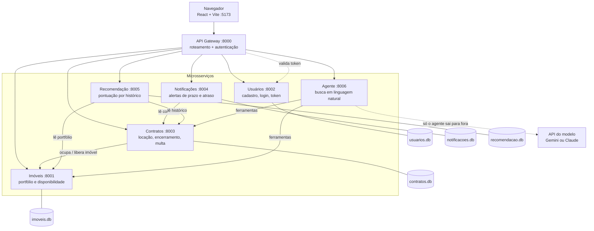

# 1 - Arquitetura de microsserviços

Sete processos. Toda requisição do navegador entra pelo API Gateway, que autentica e
encaminha. Cada serviço tem banco próprio e não fala com o banco de nenhum outro:
quando precisa de dado alheio, chama o serviço dono pela API.

## O que o desenho mostra

- **O gateway é o único ponto de entrada.** O navegador nunca fala com :8001 a :8006
  diretamente. Rotas livres: `/health`, `/services`, `/docs`, registro e login.
- **Banco por serviço.** Não há join entre serviços; a integração é por HTTP.
- **O agente é o único que sai para a internet**, para a API do Gemini ou do Claude.
  Sem `GEMINI_API_KEY` nem `ANTHROPIC_API_KEY` ele sobe e responde `/health`
  normalmente; só as rotas que pensam devolvem 503. Nenhum outro serviço depende dele.

## Por que `127.0.0.1` e não `localhost`

As URLs entre serviços usam `127.0.0.1`. No Windows, `localhost` resolve `::1` antes de
`127.0.0.1` e o uvicorn escuta só em IPv4, então cada chamada esperava o IPv6 falhar:
medido **2133 ms contra 20 ms**. Há checagem no validador para não regredir.
