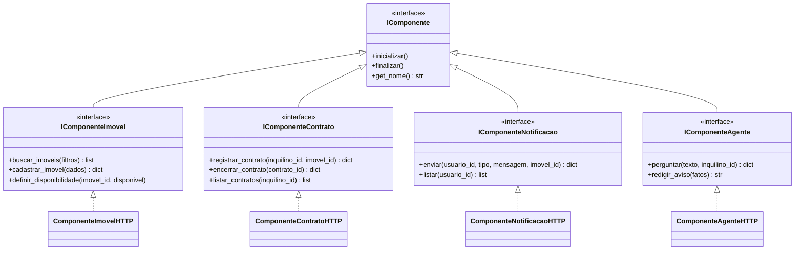

# 2 - Componentes de software

O enunciado pede microsserviços **e componentes**. Os microsserviços estão no diagrama 1;
os componentes são esta camada: contratos explícitos (`IComponente*`) com ciclo de vida
próprio, e implementações que falam HTTP com os serviços.

Quem consome componentes nunca monta requisição: chama um método.

> `IComponenteUsuario` e `IComponenteRecomendacao` seguem o mesmo padrão e foram
> omitidos para o desenho caber.

## Ciclo de vida

Todo componente tem `inicializar()` e `finalizar()`. Na prática é aí que o cliente HTTP
abre e fecha. Quem controla o ciclo é o framework (nas apps) ou o `lifespan` do FastAPI
(no serviço de agente) - nunca o código de negócio.

## Quem consome o quê

| Consumidor | Componentes que usa |
|---|---|
| `apps/app_contrato.py` | Imóvel, Contrato, Notificação |
| `apps/app_recomendacao.py` | Imóvel, Contrato, Recomendação |
| `apps/app_aviso_vencimento.py` | Contrato, Imóvel, **Agente**, Notificação |
| `services/agente/ferramentas.py` | Imóvel, Contrato |

A última linha é a que fecha o argumento: as ferramentas que o modelo enxerga são a
mesma camada que as aplicações convencionais usam. O agente não é um cliente paralelo.

Arquivos: [`framework/interfaces.py`](../biblioteca/framework/interfaces.py) e
[`framework/componentes.py`](../biblioteca/framework/componentes.py).
