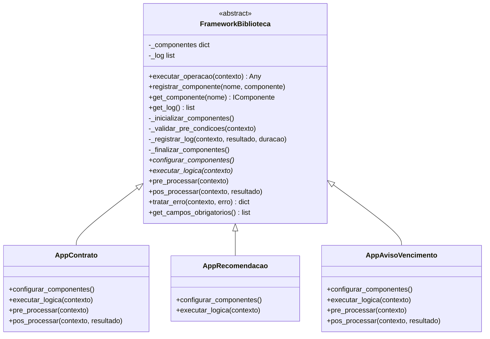
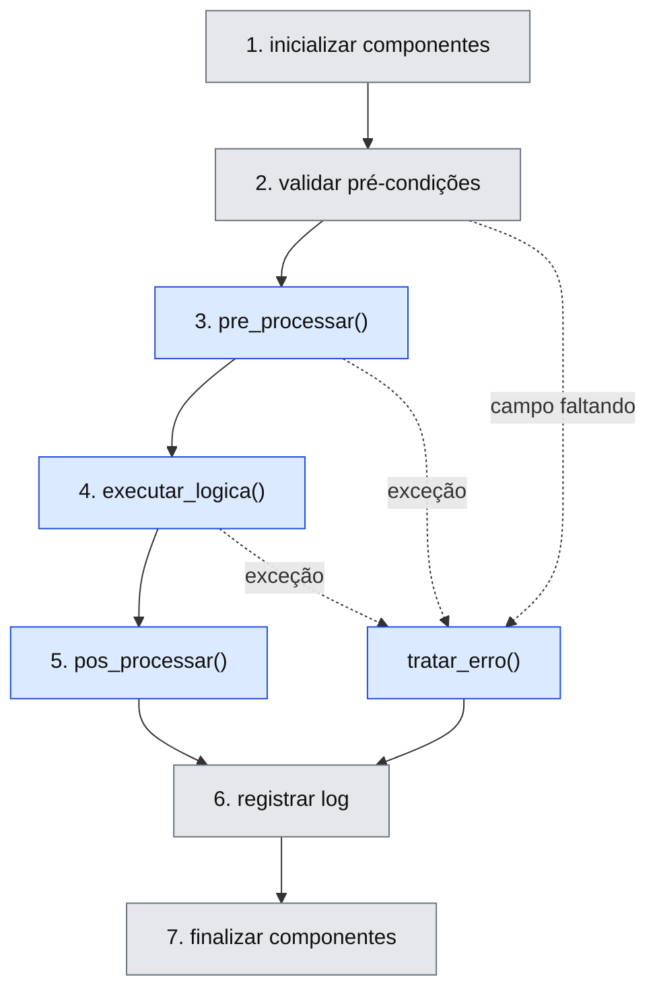

# 3 - Framework reusável (Template Method)

Herdado do trabalho de Reúso de Software e mantido intacto na migração de domínio: o
framework não menciona imóvel nem contrato em lugar nenhum. O que mudou foram as apps.

`executar_operacao()` fixa a sequência. A aplicação preenche só os pontos de adaptação.

## Frozen spots e hotspots

Cinza é do framework e não se toca. Azul é o que a aplicação implementa.

Dois hotspots são **obrigatórios** (`configurar_componentes` e `executar_logica`): são
`@abstractmethod`, então uma subclasse que esqueça um deles não instancia.

> Isso valia no projeto original só na intenção: `configurar_componentes` estava
> declarado duas vezes, e a segunda definição - concreta e vazia - apagava a primeira.
> `__abstractmethods__` continha apenas `executar_logica`, e uma app sem componentes
> rodava até falhar mais tarde em `get_componente()`. Corrigido no bloco 1, com teste.

## Garantias

- A ordem é do framework. Nenhuma app sobrescreve `executar_operacao()` - há teste.
- Componentes são finalizados **mesmo quando a lógica estoura**.
- Toda execução vira entrada de log com duração e status; o log **não guarda senha**.

Arquivo: [`framework/framework.py`](../biblioteca/framework/framework.py) ·
Testes: [`tests/test_framework.py`](../tests/test_framework.py)
