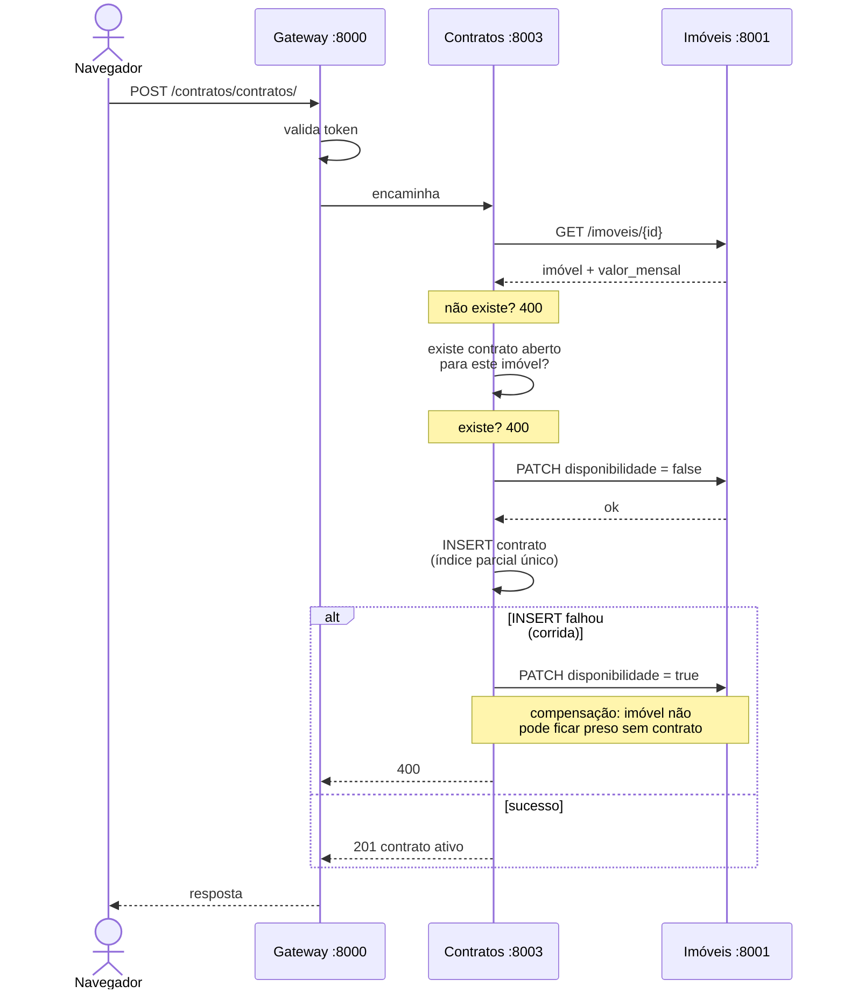
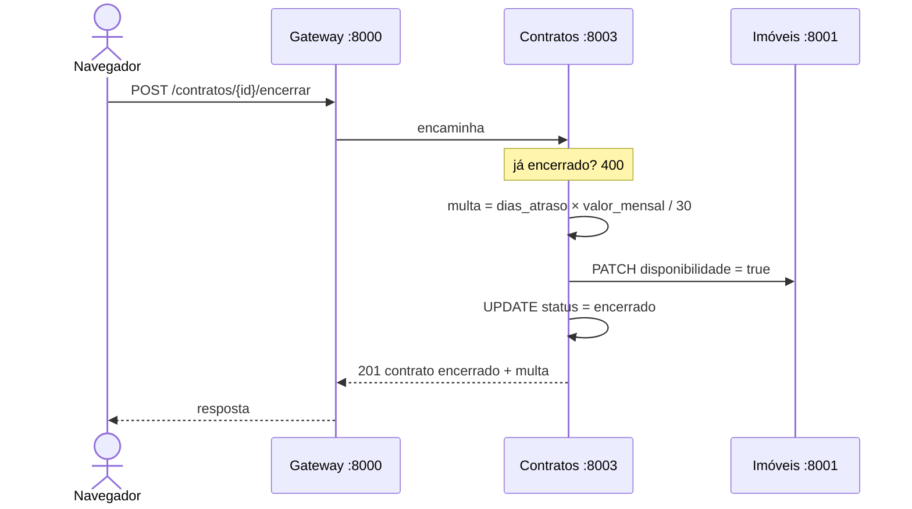

# 4 — Ciclo de um contrato

A operação central do sistema, e o lugar onde dois serviços precisam concordar sobre um
mesmo fato: o imóvel está ocupado ou não.

## Assinatura

### A regra, imposta em dois níveis

Um imóvel só aceita **um contrato em aberto**, seja qual for o inquilino — diferente do
acervo de livros, onde a checagem era por (usuário, livro) porque havia vários
exemplares do mesmo título.

1. **No serviço:** `existe_aberto(imovel_id)` antes de qualquer escrita.
2. **No banco:** índice parcial único sobre `imovel_id` onde o status está em aberto.

O segundo nível existe porque o primeiro tem janela: duas requisições simultâneas podem
passar pela checagem antes de qualquer uma inserir. Aí o índice barra a segunda, e a
compensação devolve a disponibilidade.

## Encerramento e multa

A multa é **proporcional ao aluguel contratado**, não um valor fixo: um dia de atraso
custa 1/30 do aluguel. O contrato grava o `valor_mensal` na assinatura, porque o aluguel
do imóvel pode mudar depois e a multa é sobre o que foi acordado.

Exemplo real do sistema, com 61 dias de atraso:

| Imóvel | Aluguel | Multa |
|---|---|---|
| Studio em Casa Forte | R$ 1.700 | R$ 3.513,33 |
| Cobertura na Pajuçara | R$ 5.200 | R$ 10.746,67 |

A regra mora só no serviço de contratos. A tela mostra os dias em atraso, mas não
calcula dinheiro — há checagem no validador para isso não se duplicar.

Arquivo: [`services/contratos/service.py`](../biblioteca/services/contratos/service.py) ·
Testes: [`tests/test_contratos.py`](../tests/test_contratos.py)
