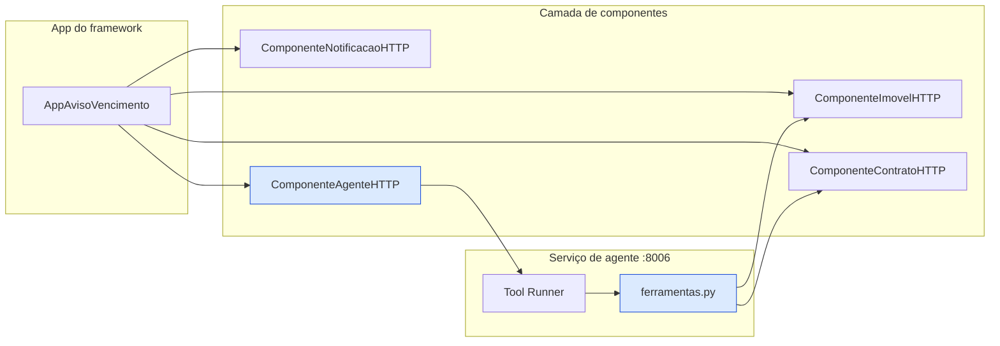
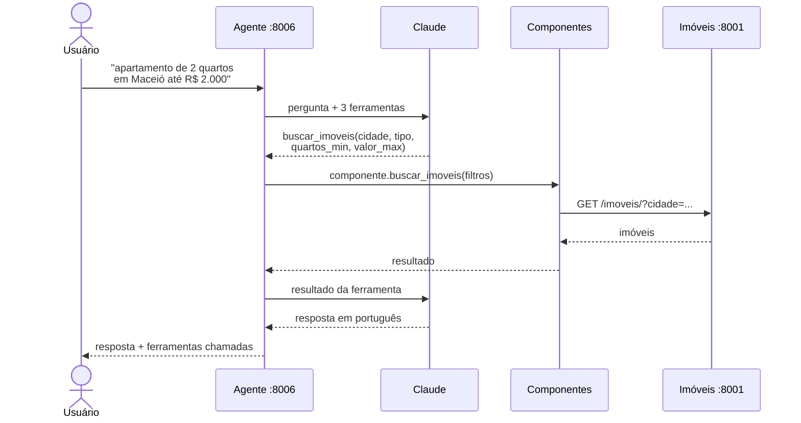
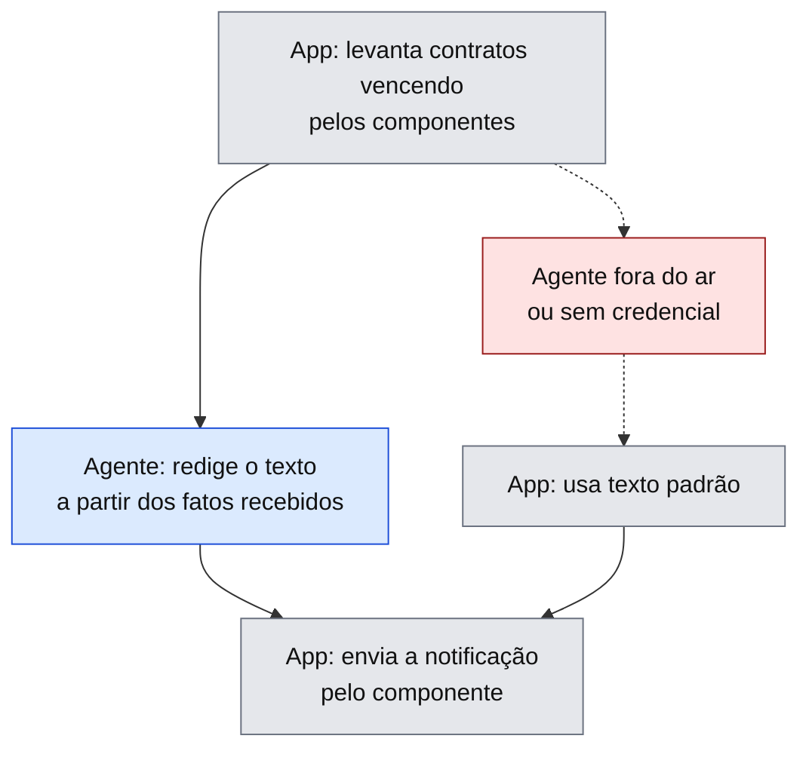

# 5 - Agente (Agentic AI)

O item opcional do enunciado. A decisão de projeto que o sustenta: **o agente usa a
mesma camada de componentes que as aplicações convencionais**, em vez de falar HTTP por
conta própria. Sem isso ele seria um apêndice pendurado ao lado do sistema.

## Simetria: consome componentes e é um componente

A caixa azul aparece dos dois lados: o agente **é** `ComponenteAgenteHTTP` para quem o
orquestra, e **usa** `ComponenteImovelHTTP`/`ComponenteContratoHTTP` como ferramentas.
Por isso a app o trata como qualquer outro serviço, sem caso especial.

## Busca conversacional

As três ferramentas são **só de leitura**: `buscar_imoveis`, `detalhar_imovel`,
`listar_contratos`. Registrar contrato é ação com efeito colateral e dinheiro
envolvido - não fica a cargo do modelo. Há checagem no validador.

## Aviso de vencimento: quem faz o quê

Dado é dado, prosa é prosa. O modelo não busca dado, não faz conta e não dispara efeito
colateral - por isso a regra de multa continua existindo num lugar só.

**O aviso é a função; o agente é o acabamento.** Com o agente fora, a app cai num texto
padrão e segue avisando. Há checagem viva que roda a app com `AGENTE_URL` numa porta
morta e exige que a notificação saia mesmo assim.

## Estado

Construído e integrado, **mas não exercitado contra o modelo real** - falta
`ANTHROPIC_API_KEY` na máquina de desenvolvimento. O que foi verificado sem chave: as
ferramentas chamando os serviços de verdade, os schemas gerados dos docstrings, e o
caminho até a API (uma chave inválida chega na Anthropic e volta 401).

Arquivos: [`services/agente/`](../biblioteca/services/agente/) ·
[`apps/app_aviso_vencimento.py`](../biblioteca/apps/app_aviso_vencimento.py)
